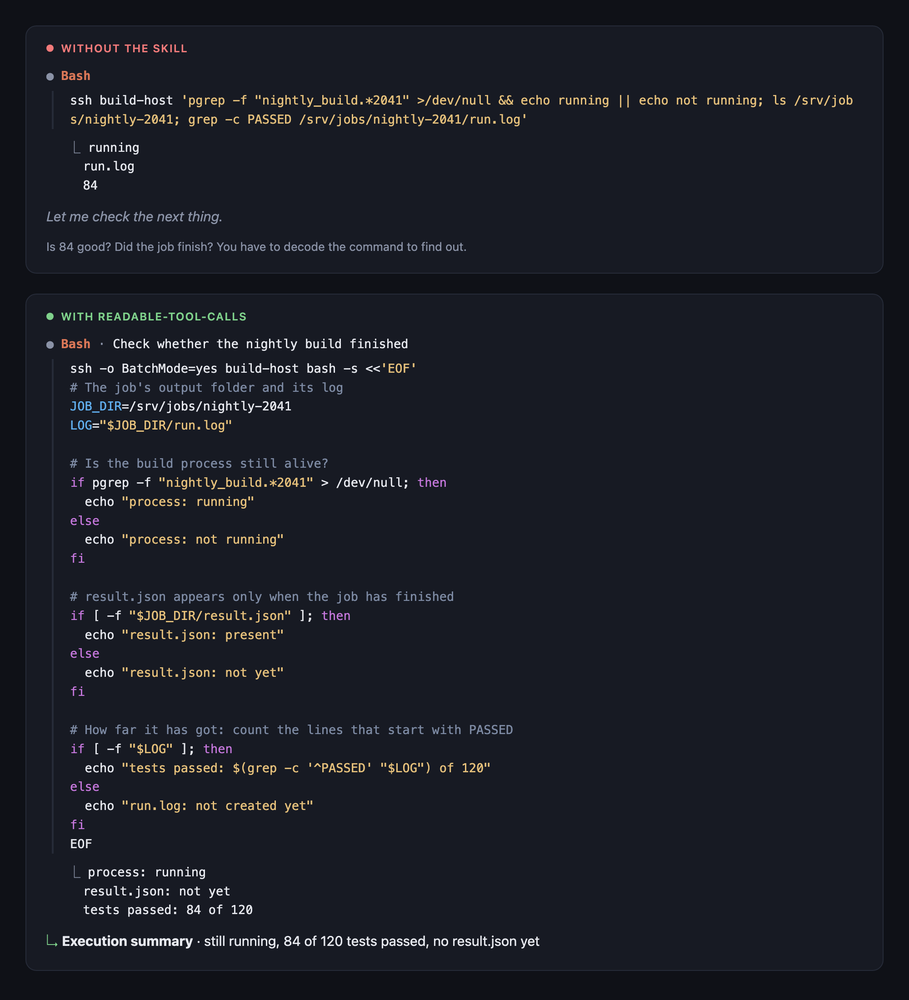

# readable-tool-calls

**Make your agent's commands human readable and get an execution summary after every tool call.**


When a coding agent works, it runs dozens of commands and edits, calls other services and hands work to subagents. You see a stream of dense one-liners and unlabeled output, and the agent rarely says what each result meant. This skill, for [Claude Code](https://claude.com/claude-code) and [Codex](https://developers.openai.com/codex), makes the agent narrate its work: commands read like a commented script, output explains itself, and every tool call ends with a one-line summary of what came back.

## Before and after

The agent checks on a nightly test job running on another machine.



Without the skill, you're left asking whether 84 is good and whether the job finished. With it, you can read the comments alone and know the plan, read the output alone and know the state, or read just the summary.

<details>
<summary>The same example as text</summary>

**Without the skill**

```bash
ssh build-host 'pgrep -f "nightly_build.*2041" >/dev/null && echo running || echo not running; ls /srv/jobs/nightly-2041; grep -c PASSED /srv/jobs/nightly-2041/run.log'
```

```
running
run.log
84
```

Is 84 good? Did the job finish? You have to decode the command to find out, and the agent has already moved on.

**With the skill**

```bash
ssh -o BatchMode=yes build-host bash -s <<'EOF'
# The job's output folder and its log
JOB_DIR=/srv/jobs/nightly-2041
LOG="$JOB_DIR/run.log"

# Is the build process still alive?
pgrep -f "nightly_build.*2041" > /dev/null \
  && echo "process: running" \
  || echo "process: not running"

# result.json appears only when the job has finished
test -f "$JOB_DIR/result.json" \
  && echo "result.json: present" \
  || echo "result.json: not yet"

# How far it has got
echo "tests passed: $(grep -c '^PASSED' "$LOG") of 120"
EOF
```

```
process: running
result.json: not yet
tests passed: 84 of 120
```

↳ **Execution summary** · still running, 84 of 120 tests passed, no result.json yet

</details>

## What it does

- **Commands read as narration.** Every step gets a comment, one step per line, and remote work goes in a heredoc script instead of a quoted one-liner.
- **Output explains itself.** Values are labeled, logs are filtered to the lines that matter, both outcomes of a check are stated, and secrets are never printed.
- **Every tool call ends with a summary.** Shell commands, file edits, calls to other services and subagents each get one line saying what came back and what it means. A batch of reads shares one.
- **It holds up in long sessions.** A short check before each reply catches dropped summaries, the usual way agents drift.
- **It changes presentation only.** The agent runs the same commands and makes the same edits; only how they are written and reported changes.

## A session at a glance

With the skill, a stretch of work reads like a log you can scan:

↳ **Execution summary** · read the three config loaders: only `load_env()` honors overrides, so the bug is in `load_file()`

↳ **Execution summary** · `cli/parser.py`: added a `--dry-run` flag to `main()`; the 12 parser tests pass

↳ **Execution summary** · full test suite: 1,204 passed, 3 skipped, none failed

↳ **Execution summary** · created issue "Retry dropped uploads" (#482) in the team tracker, assigned to nobody yet

The full rules are in [skills/readable-tool-calls/SKILL.md](skills/readable-tool-calls/SKILL.md). The root `SKILL.md` links to that same file for existing plain-skill installs.

## Install

### Claude Code

Pick one route. With both, two copies of the skill load (the plugin's is named `readable-tool-calls:readable-tool-calls`), and they can drift apart.

#### As a plugin

In a Claude Code session, add this repo as a plugin marketplace, then install the plugin:

```
/plugin marketplace add BigRedT/readable-tool-calls
/plugin install readable-tool-calls@readable-tool-calls
```

The install command opens the plugin panel, where you choose a scope before it installs. From a shell, `claude plugin marketplace add BigRedT/readable-tool-calls` and `claude plugin install readable-tool-calls@readable-tool-calls` do the same, installing for your user by default.

To update, refresh the marketplace and then the plugin:

```bash
# Refresh the marketplace, then update the installed plugin.
claude plugin marketplace update readable-tool-calls
claude plugin update readable-tool-calls@readable-tool-calls
```

#### As a plain skill

For all your projects, clone it into your user-level skills folder, and pull to update:

```bash
# Install the skill for your user.
mkdir -p ~/.claude/skills
git clone https://github.com/BigRedT/readable-tool-calls ~/.claude/skills/readable-tool-calls
# Pull subsequent updates.
git -C ~/.claude/skills/readable-tool-calls pull
```

For a single repository, copy `SKILL.md` to `.claude/skills/readable-tool-calls/SKILL.md` inside it.

### Codex

Pick either the plugin or the plain skill to avoid loading two copies.

#### As a plugin

From a shell with a Codex CLI that supports `codex plugin`, register this repository as a marketplace and install the plugin:

```bash
# Register the Git-backed marketplace.
codex plugin marketplace add BigRedT/readable-tool-calls
# Install and enable the skill plugin.
codex plugin add readable-tool-calls@readable-tool-calls
```

To update, refresh the marketplace and install its current plugin version:

```bash
# Fetch the latest marketplace snapshot.
codex plugin marketplace upgrade readable-tool-calls
# Refresh the installed plugin from that snapshot.
codex plugin add readable-tool-calls@readable-tool-calls
```

Check the installation with `codex plugin list --marketplace readable-tool-calls`, then start a new Codex session. Invoke the bundled skill as `$readable-tool-calls:readable-tool-calls`, or follow the always-on instructions below.

The package uses a portable `plugin.json`, the standard `skills/` directory, and a Codex marketplace at `.agents/plugins/marketplace.json`. See the [official plugin packaging documentation](https://developers.openai.com/plugins/build/plugins).

#### As a plain skill

Codex reads user-level skills from `~/.agents/skills`. Clone it there, and pull to update:

```bash
# Install the skill for your user.
mkdir -p ~/.agents/skills
git clone https://github.com/BigRedT/readable-tool-calls ~/.agents/skills/readable-tool-calls
# Pull subsequent updates.
git -C ~/.agents/skills/readable-tool-calls pull
```

For a single repository, copy `SKILL.md` to `.agents/skills/readable-tool-calls/SKILL.md` inside it.

### Both agents, one copy

If you use both, install the plain skill for Claude Code, then link Codex to the same folder, so one `git pull` updates both:

```bash
# Link the existing Claude Code plain-skill install into Codex's skill directory.
mkdir -p ~/.agents/skills
ln -s ~/.claude/skills/readable-tool-calls ~/.agents/skills/readable-tool-calls
```

## Make it always on

Agents load a skill when its description matches the task, so in a long session an agent can drift and stop applying it. To make it apply to every tool call, add a pointer to the instructions file your agent reads at the start of every session: `~/.claude/CLAUDE.md` for Claude Code, `~/.codex/AGENTS.md` for Codex.

```markdown
## Tool calls
- Follow the readable-tool-calls skill for every tool call, all session (as a plugin it is named readable-tool-calls:readable-tool-calls). Load it before the first tool call; it ends each tool call with a plain line `↳ **Execution summary** · <what came back and what it means>`.
```

The pointer names the skill and its one-line format; the full rules stay in the skill, so updating the skill updates them.

## Changing the skill

Edit `skills/readable-tool-calls/SKILL.md`; the root `SKILL.md` is a relative symlink, so there is only one copy to maintain. The packaged skill must be a real file because plugin installers may skip symlinks when copying packages.

Raise `version` together in `plugin.json` and `.claude-plugin/plugin.json` whenever the skill or package changes, so both agents' plugin installs pick up the new version.

To test a local checkout with Codex, register its absolute path with `codex plugin marketplace add /absolute/path/to/readable-tool-calls`, then run the same plugin install and list commands above. Use this instead of Git registration for that marketplace name. Local marketplaces read the checkout directly; `marketplace upgrade` is for Git-backed marketplaces.

If you change the example, update `assets/before-after.html` to match and render the image again (macOS, with Chrome):

```bash
# Render the updated example image with Chrome.
"/Applications/Google Chrome.app/Contents/MacOS/Google Chrome" --headless=new --hide-scrollbars \
  --force-device-scale-factor=2 --window-size=1000,900 \
  --screenshot=assets/before-after.png "file://$PWD/assets/before-after.html"
```

## License

[MIT](LICENSE)
